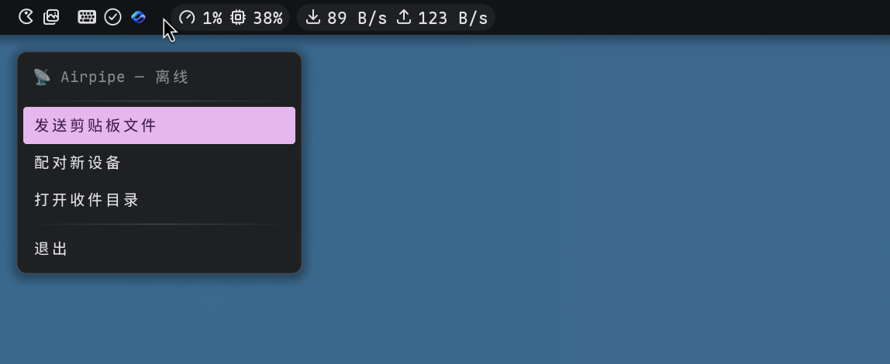
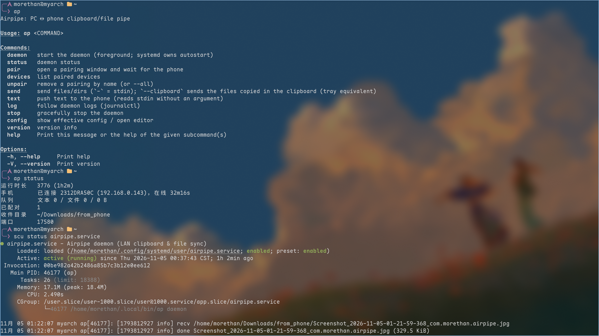
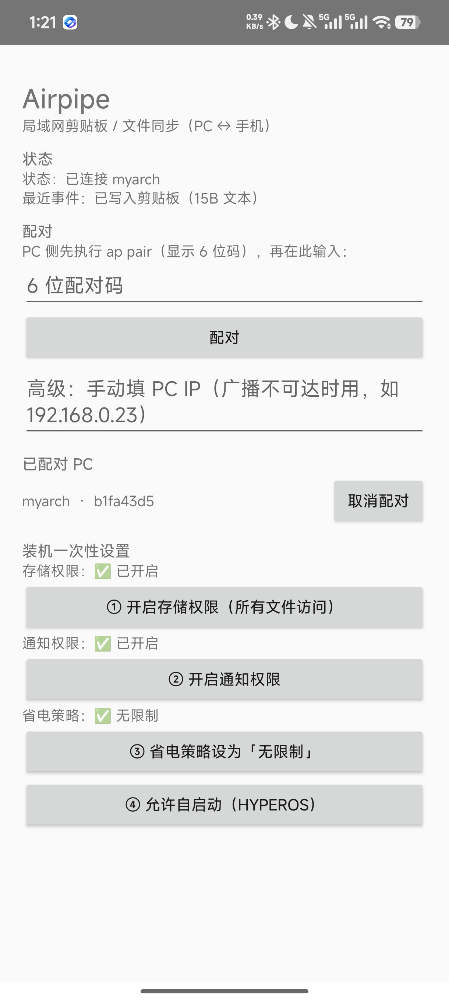
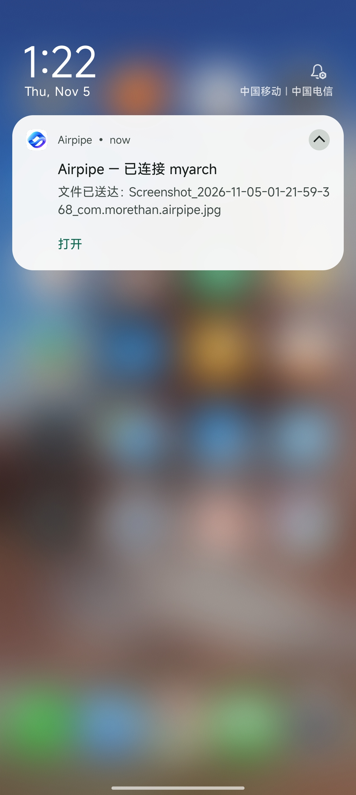
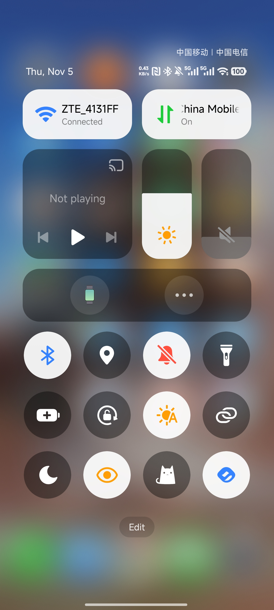
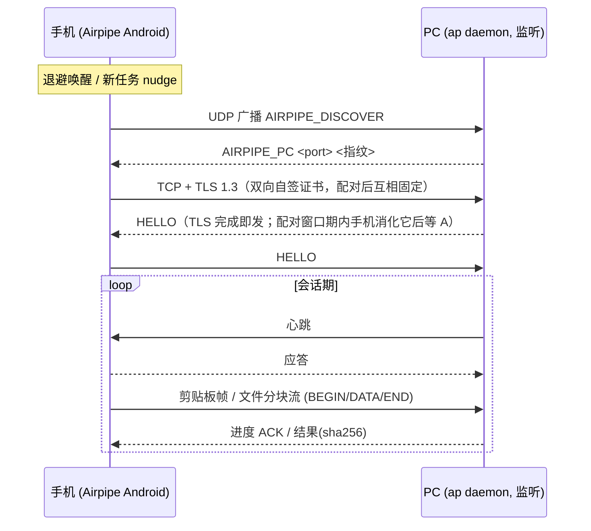

# Airpipe

局域网剪贴板 / 文件传输工具。**Air**（无线无缝）+ **Pipe**（万物皆管道流）

- 二进制名 `ap`：正常使用即客户端，`ap daemon` 启动守护进程
- PC 剪贴板文本**自动**同步到手机剪贴板（零点击）；图片自动同步默认关闭，配置 `[clipboard] auto_image = true` 开启
- 手机剪贴板文本点一下常驻通知即回 PC（通知 = 同步，打开界面用按钮/图标）
- 快捷设置磁贴 / App 内按钮一键总开关：关闭即停止轮询与常驻通知（开机、覆盖安装、分享均不自启），配对自动打开
- 文件传输：终端 `ap send` / 管道 stdin / 系统托盘 / 手机系统分享面板，四条入口
- 手机掉线时 PC 只缓存**文件路径引用**（非文件本体），手机上线自动补发；队列不持久化，重启即丢，需重传
- 全链路 TLS 1.3 双向证书认证，一次配对永久免配
- 暂只支持单 PC ↔ 单手机

## 预览

**PC 端（Linux / Wayland）**

| 系统托盘 | CLI |
| :---: | :---: |
|  |  |

**Android 端**

| App 主界面 | 常驻通知 | 状态栏磁贴 |
| :---: | :---: | :---: |
|  |  |  |

## 架构

手机 = 主动出站客户端，PC = 监听端（HyperOS 实测静默丢弃 App 入站连接，出站畅通，故别无选择；详见 android_probe 探针结论）。



## 仓库布局

```
airpipe/          本仓库：总览 + 通信协议契约文档
├── docs/protocol.md   双端共同契约：传输/加密/配对/发现/帧协议
├── assets/            项目图标 + 真机截图
├── pc/            submodule → ../airpipe-pc   (Rust, ap 命令 + daemon + 托盘)
└── android/       submodule → ../airpipe-android (Kotlin, 无三方依赖)
```

```bash
git clone --recursive https://github.com/morethan987/airpipe.git
# 或已有 clone 补拉子模块
git submodule update --init
```

## 构建与安装

### PC 端（Linux / Wayland）

```bash
cd pc
cargo build --release
install -Dm755 target/release/ap ~/.local/bin/ap
```

依赖：Wayland 合成器提供 `wlr-data-control` 协议（Hyprland/KDE/Sway 等均支持；GNOME 需第三方插件）。剪贴板后端预留了 `ClipboardBackend` 抽象，X11 以后再说。

### Android 端

```bash
cd android
./gradlew assembleDebug
adb install -r app/build/outputs/apk/debug/app-debug.apk
```

真机一次性授权（HyperOS 实测路径，详见 android/docs/behavior.md）：

```bash
adb shell appops set com.morethan.airpipe MANAGE_EXTERNAL_STORAGE allow
```

通知权限需手动：设置 → 应用管理 → Airpipe → 通知管理 → 打开；省电策略设为「无限制」（否则后台 3 秒即冻结）。

### 更换项目图标

logo 源文件：`assets/airpipe_logo.png`（透明底，≥512px）。替换后重新生成两端派生图并重编：

```bash
cargo run --release --manifest-path tools/icongen/Cargo.toml
```

- PC：重写 `pc/assets/tray_icon.png`（256px），下次 `cargo build` 时 `build.rs` 自动重烘 32/64 托盘点阵
- Android：重写 `res/mipmap-*/`（启动器 + 自适应前景）与 `res/drawable-*/ic_stat_airpipe.png`（通知剪影），重新 `assembleDebug`
- 自适应图标底色在 `android/app/src/main/res/values/colors.xml`

## 自启动（systemd 用户服务）

守护默认前台阻塞，交给 systemd 管理：

```ini
# ~/.config/systemd/user/airpipe.service
[Unit]
Description=Airpipe daemon (LAN clipboard & file sync)
PartOf=graphical-session.target
After=graphical-session.target

[Service]
ExecStart=%h/.local/bin/ap daemon
Restart=on-failure
RestartSec=3

[Install]
WantedBy=graphical-session.target
```

```bash
systemctl --user enable --now airpipe
# 曾在旧 [Install]（default.target）下 enable 过的，用 reenable 清掉旧软链，否则仍在登录时抢跑：
systemctl --user reenable airpipe
```

- `graphical-session.target` 保证拿到合成器就绪后的环境（`WAYLAND_DISPLAY`，剪贴板后端依赖）；纯监听服务无需 `network-online.target`，且用户级 unit 引用系统级 target 本就不生效
- 托盘不依赖启动顺序：状态栏（SNI host，如 noctalia/waybar）晚于守护进程启动或中途重启时，自动等待并（重）注册图标

## 快速开始

```bash
# 1. 配对（PC 端开 60 秒配对窗口，显示 6 位码）
ap pair
#    手机打开 Airpipe App → 输入 6 位码 → 完成，永久生效

# 2. 日常：PC 复制文本，手机剪贴板自动出现
#    手机复制文本 → 点一下常驻通知 → PC 剪贴板更新

# 3. 传文件
ap send photo.jpg docs/          # 文件/目录（递归；一律只落文件名/顶层目录名，不带父路径）
ap send -c                       # 发送剪贴板复制的文件（等同托盘「发送剪贴板文件」）
tar czf - logs/ | ap send -      # 管道 stdin
cat note.txt | ap text           # 文本直推手机剪贴板
#    手机：文件管理器/相册 → 分享 → Airpipe → 落 PC ~/Airpipe/from_phone/
#    PC 文件管理器复制文件 → 托盘菜单「发送剪贴板文件」或 ap send -c → 推到手机

# 4. 状态
ap status                        # 连接 / 队列 / 已配对设备
```

## 文档

- [docs/protocol.md](docs/protocol.md) — 通信协议（双端契约）
- [pc/docs/cli.md](pc/docs/cli.md) — CLI 用户接口
- [android/docs/behavior.md](android/docs/behavior.md) — 移动端行为设计

## 已知限制

- 校园网级大平面网：链路层即限杀客户端互访流量，无解也无意解；换热点 / 小路由器即一切正常
- PC 剪贴板仅实现 Wayland 后端
- 单手机场景；协议层允许 N 台已配对设备，UI 层暂不暴露
- 掉线缓存队列不持久化（设计如此）
